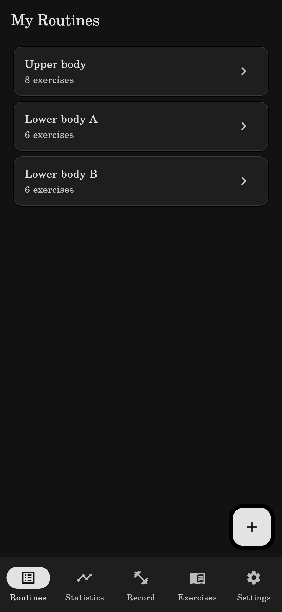
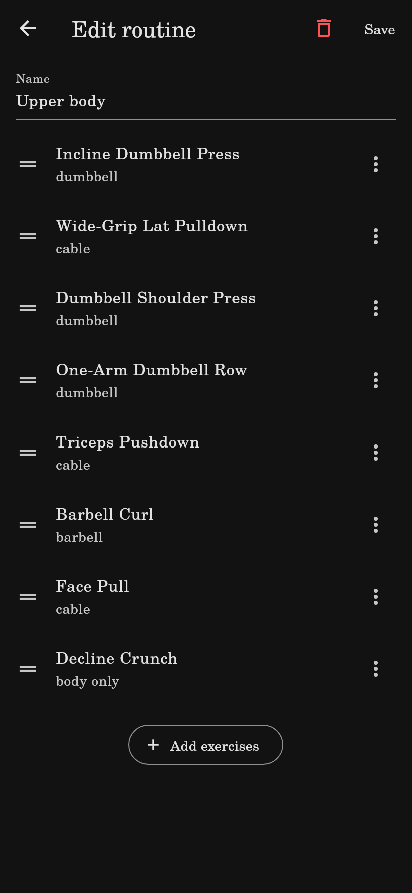
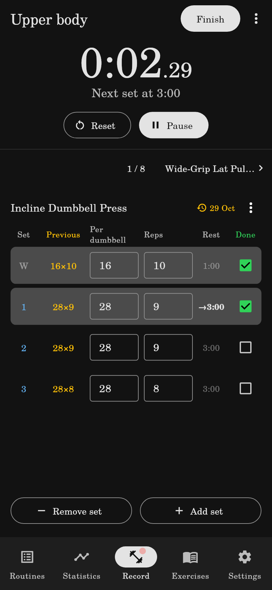
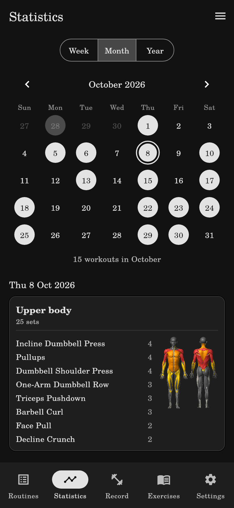
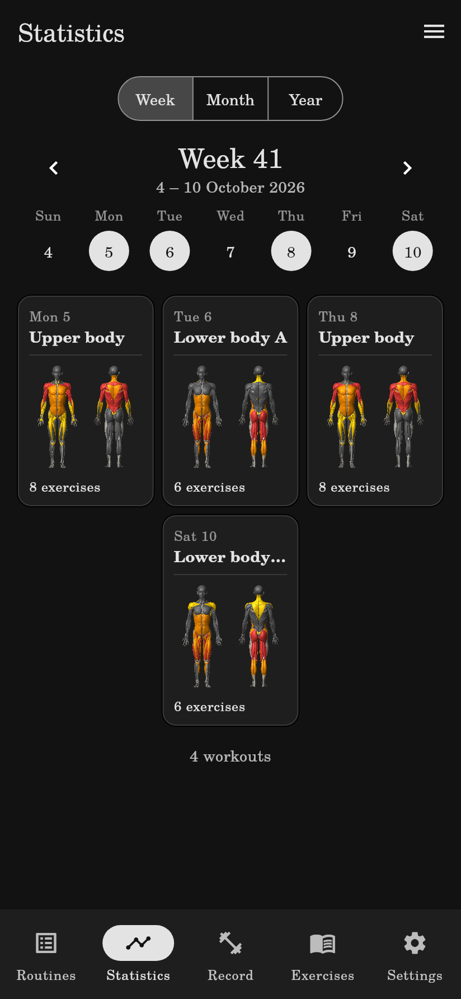
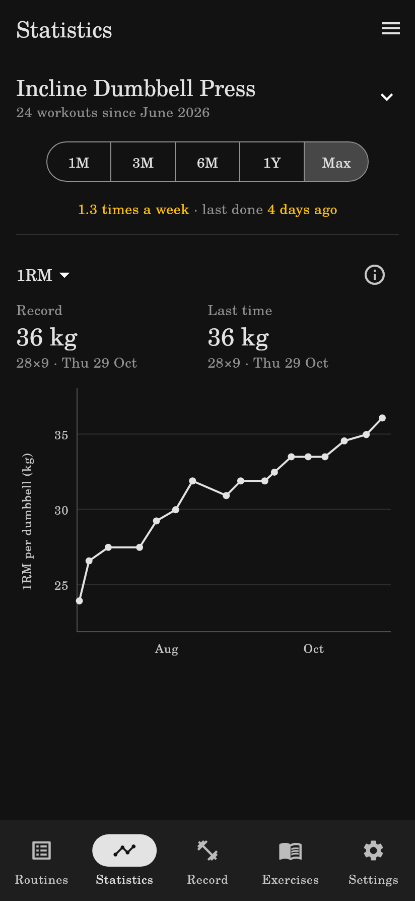
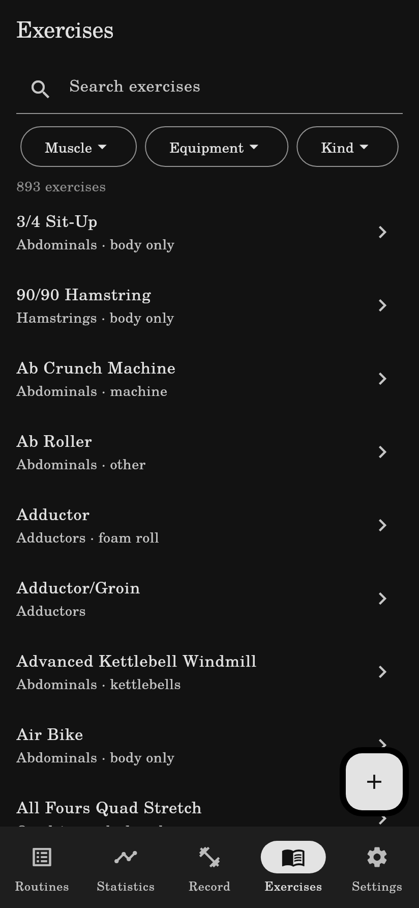
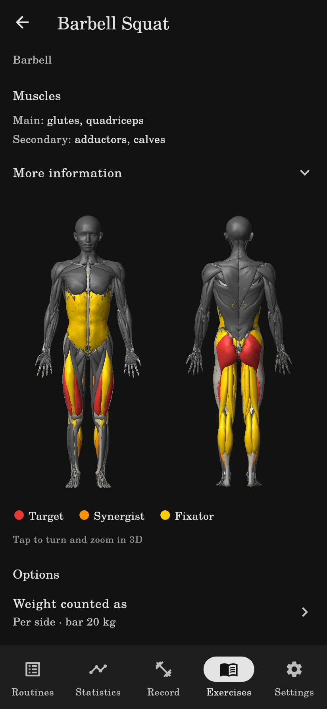
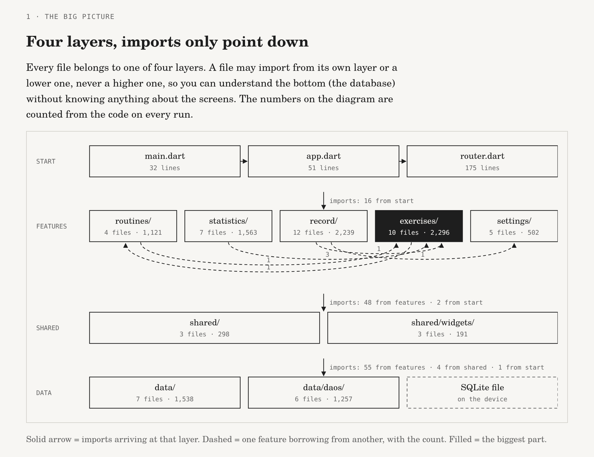

# Gym Tracker

An offline gym tracker app for Android (soon for Apple!), built with Flutter: log workouts, follow your progress and see which muscles you train.

The app is currently being used by the author on workouts. Soon, we shall have a public APK for anyone who wants to test it! 

## What it does

**Routines.** Make your own routines from our list of exercises. Choose number of sets, rest time, and customized options, such as bench inclination on your inclined bench presses to remember the angle you usually train at!

<p align="center">
  
  
</p>

**Record.** Record your workouts. It includes a timer, if you wish to time your rests/workout. 
You can choose how to record your data! Do you write that your squat is 100 kg, or do you write that you squat 40 kg per side + bar? You can log however you please!

<p align="center">
  
</p>

**Statistics.** Calendar of workouts. Shows which specific muscles are trained in your last workout!
Furthermore, see plots for your progress. Every "Record" will save data. You can see the track of your one-rep max (1RM), as well as your volume and sets.

<p align="center">
  
  
  
</p>

**Exercises.** A library of +800 exercises! Each exercise shows which muscles you use. 
Compound exercises use more than one muscle, this includes synergists, that usually grow on a lesser level than the target muscle.
You can also see its fixators, which hold you steady. There is little evidence that there is growth on most fixators, but it is good to keep track of!
We intend on checking with the literature the role of every exercise we shall record. 

<p align="center">
  
  
</p>

Your data stays on your device, so we personally do not track your data. 

## How we estimate your 1RM 
We use the exponential model of
  [Mitter et al. 2022](https://doi.org/10.1371/journal.pone.0268074), 1RM = w / 1.026 · e^(0.031 r),
  on working sets of up to 12 reps. Drop sets are left out.
  
## How do we know which exercises work which muscles?
We drew an initial list from [free-exercise-db](https://github.com/yuhonas/free-exercise-db), which only
  gives coarse primary and secondary groups. 
  We have curated a subset of these +800 exercises, checked with the literature, with fine muscles for each
  one (`assets/data/curated_muscles.json`).

## Building it

You want to skip the queue and test the app? 
You need [Flutter](https://docs.flutter.dev/get-started/install) stable 3.47.7, the version CI uses,
and the Android SDK for phone builds. `flutter doctor` shows what's missing.

```sh
flutter pub get
flutter run            # on a connected Android phone
flutter run -d linux   # as a Linux desktop app, handy for development
```

Generated `*.g.dart` files are committed, so a plain build needs no code generation. After changing
the database tables or DAOs, run `dart run build_runner build`.

If you have a Linux machine, you can also see it in your desktop.

## Code base
Check `docs/code-map.html` for a map of the current code base!

`tool/check.sh` runs `dart format`, `flutter analyze` and `flutter test`, the same steps as CI, and
refreshes the code map (it needs [uv](https://docs.astral.sh/uv/)). The script assumes Flutter is in
`~/development/flutter` and the Android SDK in `~/Android/Sdk`.



## Credits and licences

- **3D body model:** based on [Z-Anatomy](https://github.com/Z-Anatomy/Models-of-human-anatomy)
  (CC BY-SA 4.0), itself derived from BodyParts3D, © The Database Center for Life Science. The model
  (`assets/models/body.bin`) is shared under the same licence; the changes are listed in
  [BODY-MODEL-LICENSE.txt](assets/models/BODY-MODEL-LICENSE.txt).
- **Exercise data:** [free-exercise-db](https://github.com/yuhonas/free-exercise-db) (Unlicense, public
  domain).
- **App icon:** ["Atlas"](https://game-icons.net/1x1/delapouite/atlas.html) by Delapouite,
  game-icons.net, [CC BY 3.0](https://creativecommons.org/licenses/by/3.0/).
- **Font:** TeX Gyre Schola, [GUST Font License](assets/fonts/GUST-FONT-LICENSE.txt). (I'm a physicist. I like LaTeX. What did you expect? Helvetica?)

The app's own code has no licence yet.
